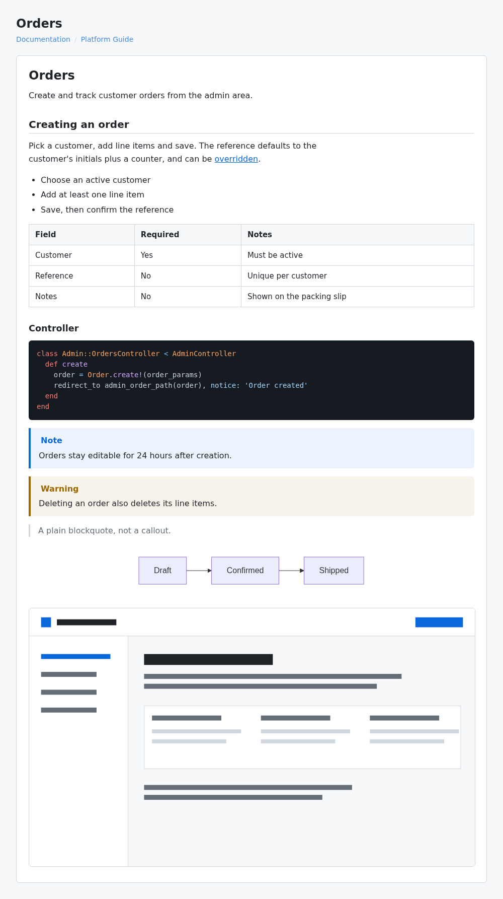

# Auto Platform Guide

Generate in-app documentation from system specs.

<picture>
  <source media="(prefers-color-scheme: dark)" srcset="docs/images/docs-dark.png">
  
</picture>

The gem documents itself: `docs/platform-guide/` is generated from
`spec/docs/` by `rake auto_platform_guide:render` and checked in CI.

- `AutoPlatformGuide::Generator` renders markdown guides from `# =` doc comments in
  system specs into `generated_docs_dir`, with an ordered README TOC grouped by
  `@category`/`@order` directives.
- `AutoPlatformGuide.setup_rspec(config)` wires system-spec screenshot support:
  `doc_screenshot('name')` captures to `screenshots_dir` when `SCREENSHOTS=true`,
  and specs run on `rack_test` unless they need a browser (`:js` tag or
  `SCREENSHOTS=true`). Browser driver is `:playwright` by default; set
  `config.browser_driver = :selenium` to use Selenium.
- The markdown viewer: `Document` + the `docs/show` template, rendered through
  `AutoPlatformGuide::DocsControllerActions`. Include it in the host app's docs
  controller so authentication stays application-owned:

  ```ruby
  class DocsController < AdminController
    include AutoPlatformGuide::DocsControllerActions
  end
  ```

  ```ruby
  # config/routes.rb
  get '/docs(/*id)', to: 'docs#show', as: 'docs'
  ```

  The shipped `docs/show` template uses plain markup and inline JavaScript; it
  needs no host helpers, partials or assets. Links are built from `docs_path`, so
  set it to the path you mount (default `/docs`). Mermaid fenced blocks render
  when a global `mermaid` is present and stay readable as source otherwise.
  Override the template in the host app to change the surrounding chrome; see
  [Styling](#styling) for the stylesheet and class contract.

## Installation

```ruby
# Gemfile
gem 'auto-platform-guide'
```

Tagged releases publish to RubyGems automatically.

## Setup

```ruby
# config/initializers/auto_platform_guide.rb
AutoPlatformGuide.configure do |config|
  config.docs_root = 'docs'
  config.docs_path = '/docs'
  config.generated_docs_dir = 'docs/platform-guide'
  config.screenshots_dir = 'docs/screenshots'
  config.specs_glob = 'spec/system/**/*_spec.rb'
  config.browser_driver = :playwright # or :selenium
  config.readme_preamble = nil
end
```

Every key is optional; the values above are the defaults. Keep
`generated_docs_dir` inside `docs_root`, since the viewer only reads from
`docs_root`.

The `:playwright` default needs `capybara-playwright-driver` in the host app;
`:selenium` needs `selenium-webdriver`. `capybara` itself is a gem dependency.
`readme_preamble` is markdown placed above the generated README's table of
contents; `nil` keeps `AutoPlatformGuide::Generator::README_PREAMBLE`. Note:
`:selenium` support is unit-tested with mocked drivers — no CI job boots a real
browser under either driver.

### Translated guides

The English `# =` comments in a spec stay the source. To add a language, list it
and put one translation file next to each documented spec:

```ruby
config.locales = ['pt-BR']
```

```yaml
# spec/system/orders_spec.pt-BR.yml
source_digest: 1a2b3c4d5e6f   # printed by the error when it is missing or outdated
sections:                     # same order and count as the `# =` / `# ==` headings
  - title: Pedidos
    body: |
      Crie e acompanhe pedidos de clientes.
  - title: Criar um pedido
    body: Escolha um cliente, adicione itens e salve.
```

Add `category: Pedidos` at the top level of the file to translate the spec's
`@category` in the README, and set the README's fixed texts per locale (anything
left out stays English):

```ruby
config.localized_readme = {
  'pt-BR' => { 'preamble' => "<h1 id=\"guia\">Guia</h1>\n\nTexto...\n", 'contents' => 'Índice' }
}
```

Guide titles and breadcrumbs come from the guide's first heading, so translated
guides show their translated title.

`rake auto_platform_guide:generate` writes `ORDERS.pt-BR.md` and `README.pt-BR.md`
beside the English files, and `auto_platform_guide:check` fails when a translation
is missing, has a different section count, or its `source_digest` no longer matches
the English comments (that is how a changed English paragraph is noticed).

Screenshots are captured once more per locale, with `DOC_LOCALE=<locale>` set and
`I18n.locale` switched by `setup_rspec`, and saved under `screenshots_dir/<locale>/`.
A host that does not use `setup_rspec` must switch its own locale from `DOC_LOCALE`.
Serving the right file for the visitor's locale is up to the host.

```ruby
# spec/rails_helper.rb
require 'auto_platform_guide/rspec'

RSpec.configure do |config|
  AutoPlatformGuide.setup_rspec(config)
end
```

## Styling

The gem ships plain markup and one optional stylesheet. Generate it into the
app and import it:

```bash
bin/rails generate auto_platform_guide:styles
```

```css
@import "docs";
```

Every rule is scoped to the classes the gem emits, so it will not leak. Colours,
fonts and radii are `--apg-*` custom properties on `:root`; dark mode follows
`prefers-color-scheme`. Code blocks stay dark in both schemes because Rouge
writes token colours inline. See [Styling](docs/platform-guide/STYLING.md) for
the class contract and how to change the code block theme.

## Writing a documented spec

Doc comments are parsed from the files matched by `specs_glob`. A spec file is
picked up when it has a `# = Heading` at column 0.

```ruby
# spec/system/orders_spec.rb
require 'rails_helper'

# @category Orders
# @order 200
#
# = Orders
# Create and track customer orders.
#
# == Creating an order
# Pick a customer, add line items and save.

RSpec.describe 'Orders', type: :system do
  it 'creates an order' do
    visit new_admin_order_path

    fill_in 'Reference', with: 'ORD-1'
    click_button 'Save'
    expect(page).to have_content('Order created')

    doc_screenshot('orders/created')
  end
end
```

- `# = Heading` renders as `<h1>`; every extra `=` adds a level (`# ==` → `<h2>`).
- Comment lines after a heading are its body, up to the next heading or the first
  non-comment line. Sections can also sit directly above the examples they describe.
- `@category` and `@order` only place the guide in the README TOC; they are
  stripped from the body. Specs without them fall under `Other` / `999_999`.
- The generator parses comments and embeds only screenshots whose PNG already
  exists on disk. `generate` runs the spec first to capture them; `render` and
  `check` never run specs.

`doc_screenshot('orders/created')` writes `docs/screenshots/orders/created.png`
when screenshots are enabled, and does nothing otherwise.

## Capturing screenshots

```bash
SCREENSHOTS=true bundle exec rspec spec/system/orders_spec.rb
rake auto_platform_guide:generate
```

`SCREENSHOTS=true` drives every system example in that run through the configured
browser (`:playwright` by default) and saves each `doc_screenshot` call. Without
it, system specs use `rack_test`; tag individual examples `:js` when only they
need a browser.

The helper is included for `type: :system` only, so keep that metadata. A
screenshot is rendered after the heading block that precedes its call.

## Rake tasks

Generating docs is a rake task shipped with the gem. Rails apps load it through
the engine; anywhere else, require it from your `Rakefile`:

```ruby
require 'auto_platform_guide/rake_tasks'
```

```bash
rake auto_platform_guide:generate                      # all documented specs
rake "auto_platform_guide:generate[spec/foo_spec.rb]"  # one spec
rake auto_platform_guide:check                         # verify docs; non-zero when stale
rake auto_platform_guide:readme                        # rebuild the README TOC
rake auto_platform_guide:render                        # re-render, reuse screenshots on disk
```

## Tests

```bash
bin/setup
bundle exec rspec
```
