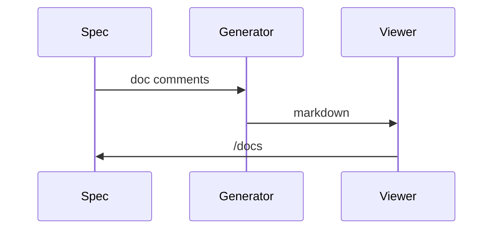

<!--
Generated: 2026-10-29 19:23:47 UTC
-->

<h1 id="markdown-rendering">Markdown rendering</h1>

Redcarpet parses and Rouge highlights. Fenced code, tables, autolinks and
strikethrough are enabled, and a light Obsidian layer adds wikilinks and
callouts on top.


<h2 id="code">Code</h2>


```ruby
AutoPlatformGuide.configure do |config|
  config.generated_docs_dir = 'docs/platform-guide'
end
```

```javascript
document.addEventListener('turbo:load', renderDiagrams)
```

```yaml
auto_platform_guide:
  docs_root: docs
  specs_glob: spec/system/**/*_spec.rb
```


<h2 id="mermaid">Mermaid</h2>




Mermaid blocks become `<pre class="mermaid">` and are never syntax-highlighted.
A global `mermaid` object renders them in the viewer; without one the source
stays readable.


<h2 id="callouts">Callouts</h2>


> [!NOTE]
> Neutral context.

> [!TIP]
> A shortcut.

> [!IMPORTANT]
> Something that matters.

> [!WARNING]
> Something that can break.

> [!CAUTION]
> Something destructive.


<h2 id="tables">Tables</h2>


| Feature | Value |
| --- | --- |
| Parser | Redcarpet |
| Highlighter | Rouge |
| Diagrams | Mermaid |


<h2 id="links">Links</h2>


Standard markdown links work everywhere: [the overview](OVERVIEW.md) resolves
in the viewer and on GitHub.

The viewer also converts Obsidian-style wikilinks such as
`[[OVERVIEW|the overview]]`, but other markdown readers, GitHub included, show
them literally.


<h2 id="theme-aware-images">Theme-aware images</h2>


The `<picture>` pattern renders, so one image can follow the reader's colour
scheme:

```html
<picture>
  <source media="(prefers-color-scheme: dark)" srcset="dark.png">
  
</picture>
```

Redcarpet predates the element and treats it as inline HTML, so the block is
collapsed onto one line before parsing; otherwise `hard_wrap` would insert
`<br>` inside it. The tags and their `media`, `srcset`, `sizes` and `type`
attributes pass the sanitizer. The `` is the fallback for renderers
without `<picture>` support.
