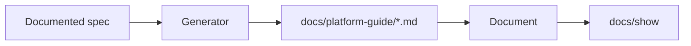

<!--
Generated: 2026-10-23 02:00:12 UTC
-->

<h1 id="auto-platform-guide">Auto Platform Guide</h1>

Turn documented system specs into an in-app guide served at `/docs`.


<h2 id="how-it-fits-together">How it fits together</h2>




The generator parses `# =` comment blocks from the files matched by
`specs_glob` and writes one markdown file per spec. The viewer renders those
files with Redcarpet and Rouge and serves them through the host app's
controller.


<h2 id="install">Install</h2>


```ruby
# Gemfile
gem 'auto-platform-guide', github: 'mauriciozaffari/auto-platform-guide', branch: 'main'
```


<h2 id="configure">Configure</h2>


Defaults shown; every key is optional.

```ruby
# config/initializers/auto_platform_guide.rb
AutoPlatformGuide.configure do |config|
  config.docs_root = 'docs'
  config.generated_docs_dir = 'docs/platform-guide'
  config.screenshots_dir = 'docs/screenshots'
  config.specs_glob = 'spec/system/**/*_spec.rb'
  config.browser_driver = :playwright
  config.readme_preamble = nil
end
```

`readme_preamble` replaces the markdown above the generated README's table of
contents.

> [!NOTE]
> `docs_root` is what `Document` reads; `generated_docs_dir` is where the
> generator writes. Keep the output inside the docs root or the viewer will
> not find it.
