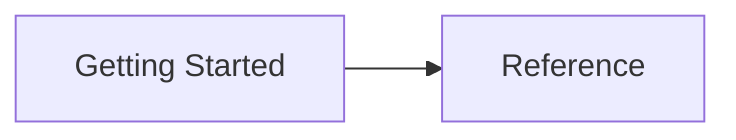

<!--
Generated: 2026-10-29 19:16:19 UTC
-->

<h1 id="platform-guide">Platform Guide</h1>

Usage and reference for the auto-platform-guide gem, generated from the
documented specs in `spec/docs/`. Every page is rendered by the gem it
describes: Redcarpet, Rouge, Mermaid, wikilinks and callouts.

<h2 id="table-of-contents">Table of Contents</h2>

<h3 id="getting-started">Getting Started</h3>

- [Auto Platform Guide](OVERVIEW.md)
- [Documenting specs](DOCUMENTING-SPECS.md)

<h3 id="reference">Reference</h3>

- [Rake tasks](RAKE-TASKS.md)
- [Docs viewer](DOCS-VIEWER.md)
- [Styling](STYLING.md)
- [Markdown rendering](MARKDOWN-RENDERING.md)
