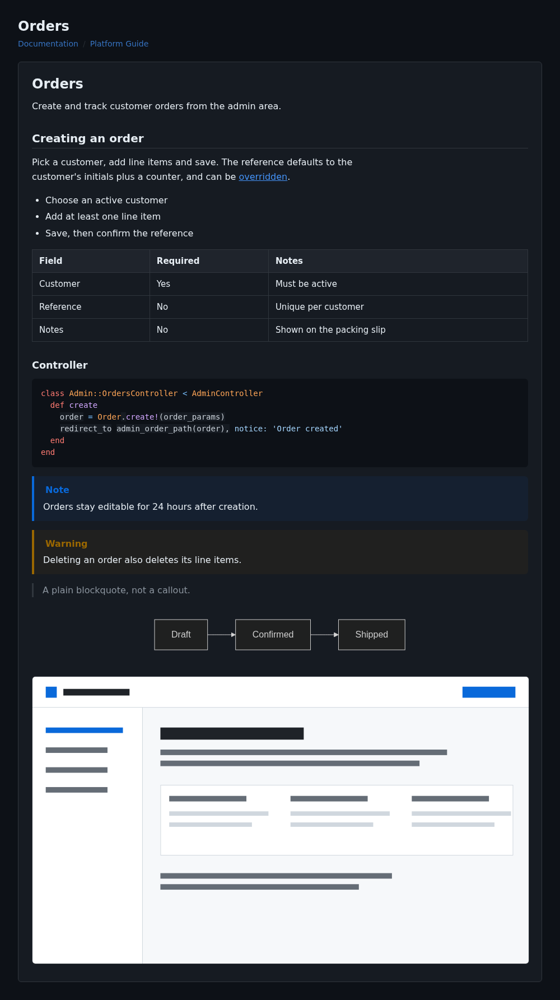

<!--
Generated: 2026-10-29 19:16:19 UTC
-->

<h1 id="styling">Styling</h1>

The gem emits plain markup and ships one optional stylesheet; the host app
owns the look. `app/assets/stylesheets/auto_platform_guide/docs.css` is a
minimal starting point.


<h2 id="preview">Preview</h2>

Light and dark, using the shipped stylesheet:





<h2 id="markup">Markup</h2>

The shipped template wraps the rendered markdown in two sections:

```html
<section class="content-header">
  <h1>Title</h1>
  <ol class="breadcrumb">...</ol>
</section>

<section class="content documentation">
  <div class="box">
    <div class="box-body">
      <!-- rendered markdown -->
    </div>
  </div>
</section>
```

| Class | Emitted by | Wraps |
| --- | --- | --- |
| `content-header` | template | Title and breadcrumb |
| `breadcrumb` | template | Breadcrumb list |
| `box`, `box-body` | template | Card around the markdown |
| `documentation` | template | The rendered markdown |
| `callout callout-<type>` | renderer | Note, tip, important, warning, caution |
| `callout-title` | renderer | Callout heading and icon |
| `code-block` | renderer | Fenced code |
| `language-<tag>` | renderer | Lexer of the block, e.g. `language-ruby` |
| `mermaid` | renderer | Diagram source |
| `img-responsive` | renderer | Images from `doc_screenshot` |

Headings, paragraphs, lists, tables and links carry no class, so style them as
bare elements inside `.documentation`.


<h2 id="minimal-stylesheet">Minimal stylesheet</h2>

Generate it:

```bash
bin/rails generate auto_platform_guide:styles
```

That writes `app/assets/stylesheets/docs.css`. Import it from the application
stylesheet, or serve it on its own with `stylesheet_link_tag 'docs'`:

```css
@import "docs";
```

It is plain CSS with no build step. Every rule is scoped to the classes above,
so it cannot leak into the rest of the app. The `.content-header` block is the
only exception: drop it when the app already styles that chrome.


<h2 id="theming">Theming</h2>

Colours, fonts and radii are custom properties on `:root`, all prefixed
`--apg-`. Override them after the import instead of editing rules:

```css
:root {
  --apg-accent: #0f766e;
  --apg-radius: 2px;
  --apg-font: "Inter", system-ui, sans-serif;
}
```

Dark mode follows `prefers-color-scheme`. Point that block at the app's own
toggle when it has one:

```css
html.dark {
  --apg-fg: #e6edf3;
  --apg-surface: #161b22;
}
```


<h2 id="code-blocks">Code blocks</h2>

Rouge renders tokens with `Rouge::Formatters::HTMLInline` and
`Rouge::Themes::Github.mode(:dark)`, so every token carries an inline `style`
attribute and CSS cannot recolour it. The stylesheet keeps the block on the
theme's own background so the colours stay legible in either colour scheme.

A light block needs the renderer changed. The gem exposes no hook for it, so
reopen the class in an initializer:

```ruby
# config/initializers/auto_platform_guide.rb
AutoPlatformGuide::Document::Renderer.class_eval do
  def block_code(code, language)
    return content_tag(:pre, code, class: 'mermaid') if language == 'mermaid'

    lexer = Rouge::Lexer.find_fancy(language.to_s, code) || Rouge::Lexers::PlainText.new
    html = Rouge::Formatters::HTMLInline.new(Rouge::Themes::Github.new).format(lexer.lex(code))

    content_tag(:pre, class: 'code-block') do
      content_tag(:code, sanitize(html), class: "language-#{lexer.tag}")
    end
  end
end
```

`Rouge::Themes::Github.new` is the light variant;
`Rouge::Themes::Github.mode(:dark).new` is the shipped one.


<h2 id="callout-icons">Callout icons</h2>

Callout titles contain `<i class="fa fa-info-circle">` and friends. Without
Font Awesome the icon is blank and the text still reads correctly.


<h2 id="replacing-the-chrome">Replacing the chrome</h2>

Override `app/views/docs/show.html.erb` in the host app to change the header,
breadcrumb or card. Keep `documentation` on the element that holds
`@document.render`, or the stylesheet stops matching.

> [!WARNING]
> The renderer sets `hard_wrap`, so a single newline becomes `<br>` and CSS
> cannot remove it. Leave a blank line between paragraphs in doc comments.
